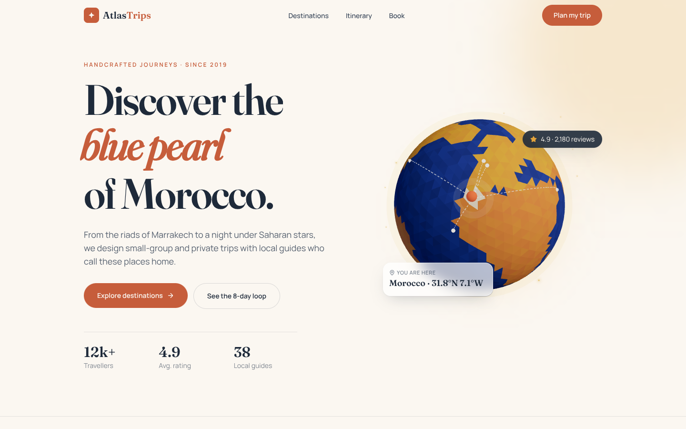
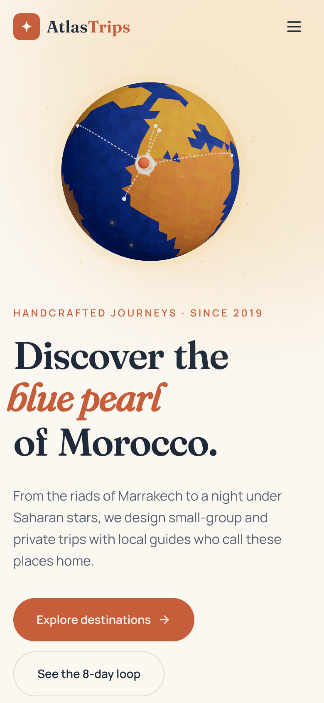

# Atlas Trips

> A Morocco travel landing page and destination explorer, from the blue lanes of Chefchaouen to the dunes of Merzouga.



<p align="center"></p>

## Features

- **Real-time 3D globe** in the hero, built entirely in code with React Three Fiber: a low-poly icosahedron whose faces are coloured by a procedural continent map, a pulsing marker on Morocco and dashed flight arcs to Paris, London, New York, Dubai and Dakar. Drag to spin; it also turns with scroll. Lazy-loaded with `React.lazy` + `Suspense`, DPR capped at 2, with a CSS fallback when WebGL is unavailable.
- **Editorial hero** with a staggered word reveal, a rotating italic headline ("red city", "blue pearl", "golden dunes"...), scroll-linked parallax and magnetic call-to-action buttons.
- **Intro curtain** that wipes away on load, and a **scroll-linked marquee** of destination names (solid and outlined rows moving in opposite directions).
- **Sticky "crossroads" section**: a 300vh scroll story where facts fade and slide in step with `useScroll`, while an illustrated arch swaps scenes and tilts.
- **Destination explorer**: 9 Moroccan destinations filterable by region and landscape type. Cards re-flow with layout animations and a sliding active-chip indicator.
- **Shared-layout detail modal**: the card expands into a full detail view using `layoutId` (image, title and card surface all morph), closes with Esc or backdrop click.
- **Scroll-driven itinerary**: an 8-day Marrakech to Fès timeline whose progress line is drawn with `useScroll` while each day slides in on view.
- **Booking form** with live validation (Moroccan phone format, no past dates), animated error messages, a shake on invalid submit, a live price estimate and an animated success checkmark.
- **Zero external images**: every destination is a hand-built SVG scene (dunes, medina, kasbah, Atlas peaks, Atlantic ramparts) with a zellige pattern overlay.
- Responsive from 375px, keyboard accessible, and honours `prefers-reduced-motion`.

## Tech stack


## Getting started

```bash
npm install
npm run dev      # start the dev server on http://localhost:5173
npm run build    # production build in dist/
npm run preview  # serve the production build
```

## Project structure

```
src/
├── components/
│   ├── Navbar.jsx            # glass-on-scroll header + animated mobile menu
│   ├── Curtain.jsx           # intro wipe
│   ├── Hero.jsx              # editorial headline, parallax, lazy 3D globe
│   ├── Magnetic.jsx          # cursor-following magnetic wrapper
│   ├── Marquee.jsx           # scroll-linked kinetic type
│   ├── Crossroads.jsx        # sticky scroll story
│   ├── Explorer.jsx          # filters, layout-animated grid, modal orchestration
│   ├── FilterChips.jsx       # chip group with shared layoutId indicator
│   ├── DestinationCard.jsx   # card with layoutId hooks
│   ├── DestinationModal.jsx  # shared-layout detail view
│   ├── DestinationArt.jsx    # parametric SVG landscapes
│   ├── Itinerary.jsx         # scroll-linked timeline
│   ├── Booking.jsx           # validated form + estimate + success state
│   ├── Reveal.jsx            # whileInView helper
│   └── Footer.jsx
├── three/
│   ├── Globe.jsx             # procedural low-poly globe, marker, flight arcs
│   └── webgl.js              # WebGL feature detection for the fallback
├── data/
│   ├── destinations.js       # mock destinations, prices in MAD
│   └── itinerary.js
├── App.jsx
├── main.jsx                  # MotionConfig reducedMotion="user"
└── index.css                 # Tailwind layers + component classes
```

## Design notes

**Palette** — drawn from Moroccan materials: sand `#F4EBDD` for the canvas, terracotta clay `#C65D3B` (the walls of Marrakech) as the primary action colour, deep ink `#1E2A3A` for text and the itinerary section, saffron `#E3A33B` for highlights and Majorelle blue `#2F4BA8` inside the illustrations.

**Typography** — [Fraunces](https://fonts.google.com/specimen/Fraunces) for display headings, with its soft italic used for the rotating word, paired with [Manrope](https://fonts.google.com/specimen/Manrope) for UI and body text. The serif brings an editorial, travel-magazine feel; Manrope keeps forms and data crisp.

**Motion** — motion is used to explain, not decorate:
- Spring physics (`stiffness 300–400`) for UI feedback (chips, toggles, steppers) so they feel tactile.
- A custom ease `[0.22, 1, 0.36, 1]` for content reveals, so sections settle gently.
- `layoutId` keeps context when opening a destination: the card *becomes* the modal.
- `useScroll` + `useSpring` tie the itinerary line and the top progress bar to reading position; `useTransform` drives the hero parallax, the marquee and the sticky crossroads story.
- The 3D globe is the one "wow" moment: calm idle rotation, damped with `THREE.MathUtils.damp` so scroll input never snaps, and the marker pulse echoes the "you are here" card.
- Magnetic buttons use springs on `x`/`y` motion values and switch off under reduced motion.
- Everything respects the OS reduced-motion setting through `<MotionConfig reducedMotion="user">`.

## Author

**Zakaria Dabella** — UI/UX designer & web developer based in Casablanca, Morocco.

- Portfolio: [zakaria-dabella-portfolio.vercel.app](https://zakaria-dabella-portfolio.vercel.app/)
- GitHub: [@zakaria10-dabella](https://github.com/zakaria10-dabella)

## License

[MIT](LICENSE) © 2026 Zakaria Dabella
